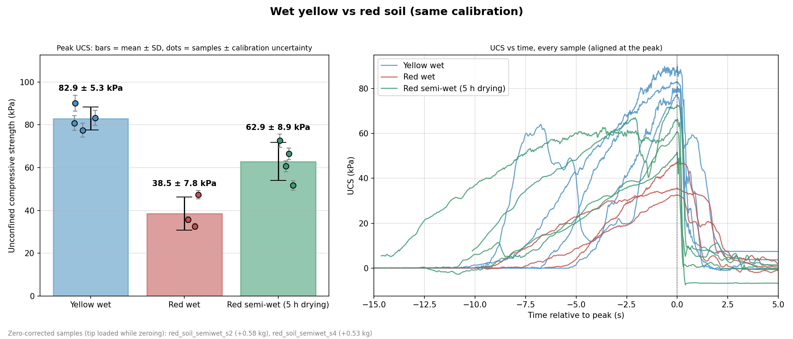

# 1.5 inch tip soil penetrometer

Code, calibration and test results for the 1.5 in (38.1 mm) flat tip of the digital soil
penetrometer (NJIT independent study). The tip is pushed into a soil sample by hand. A load cell
records the force at about 40 Hz, and the peak pressure on the tip is reported as an
estimate of the unconfined compressive strength (UCS).



| Soil | n | UCS (kPa), mean ± SD | CV |
|---|---|---|---|
| Yellow, wet (2026-10-20) | 4 | **82.9 ± 5.3** | 6 % |
| Red, wet (2026-10-16) | 3 | **38.5 ± 7.8** | 20 % |
| Red, semi-wet, 5 h drying (2026-10-16) | 4 | **62.9 ± 8.9** | 14 % |

All three groups use the same calibration (see [Calibration](#3-calibration)).
Per-sample values are in [`data/compare_20261020_115123.csv`](data/compare_20261020_115123.csv).

---

## 1. Hardware

| Part | Details |
|---|---|
| Microcontroller | Adafruit ESP32-S3 Feather |
| ADC | NAU7802, 24-bit, gain 128, 80 SPS, each output is the average of 2 readings (≈ 40 Hz) |
| Load cell | 50 kg half-bridge (bathroom-scale type) |
| Tip | flat, 1.5 in diameter, area A = π (0.0381 m / 2)² = 1.140 × 10⁻³ m² (1140 mm²) |

The firmware ([`firmware/src/main.cpp`](firmware/src/main.cpp), PlatformIO project in
[`firmware/`](firmware/)) streams `millis,raw` lines over USB serial at 115200 baud. All
conversion to force is done on the PC, so the calibration can be changed later without
re-flashing the board, and old recordings can be re-scaled.

## 2. Scripts

| Script | What it does |
|---|---|
| [`common.py`](common.py) | Shared settings: tip geometry, serial port auto-detection, calibration file I/O, unit conversion, uncertainty |
| [`preflight_check.py`](preflight_check.py) | ~1 min check before testing: connection, sample rate, timing gaps, zero noise and drift, saturation, one known weight. Prints PASS / WARN / FAIL |
| [`characterize.py`](characterize.py) | Loads known weights in steps and measures accuracy, linearity, repeatability, hysteresis, zero return, noise and creep. Writes `characterization/char_<time>/` and `characterization.json` |
| [`save_calibration.py`](save_calibration.py) | Quick two-point calibration using the firmware's built-in routine |
| [`record.py`](record.py) | Records one test: `1` + Enter zeroes and starts, `2` + Enter stops. Saves CSV, Excel, a quick-look PNG and a `_meta.json` |
| [`remote_record.py`](remote_record.py) | Runs `record.py` without the keyboard (starts at once and stops when a `STOP` file appears). Used so one person can push the probe while the other runs the computer |
| [`postprocess.py`](postprocess.py) | Peak force, peak UCS ± uncertainty, test start, time to peak and loading rate for each recording. Writes `_analysis.png`, `_processed.csv` and `summary_<time>.csv` |
| [`compare.py`](compare.py) | Compares groups (one `data/` subfolder per group): bar chart of mean ± SD with each sample, and UCS-vs-time curves aligned at the peak |

Requirements: Python 3 with `numpy`, `matplotlib`, `pyserial`, `openpyxl`.

## 3. Calibration

### Model

```
force (kg) = (raw − zero) × factor          stored in calibration.txt (line 1: zero, line 2: factor)
```

Every test is re-zeroed (tared) when recording starts, so the `zero` in `calibration.txt`
cancels out. **Only the factor (kg per ADC count) affects the results.**

### Method: bracketed zeros, one factor through the origin

The load-cell zero drifts slightly and jumps a little each time a weight is placed. A
calibration that uses a single zero taken at the start would carry that drift into the
factor. Each weight was therefore measured as:

1. zero reading (empty, settled ~8 s, averaged),
2. loaded reading (weight placed, settled, averaged),
3. zero reading again.

The net signal for that weight is `loaded − mean(zero before, zero after)`. This gives
counts per kg for every point. One factor through the origin was then chosen to minimize the
**largest relative error** over all points. Relative error is used because soil results
span roughly 3–10 kg, and a percent error means the same thing at any load.

**Preload first.** The first heavy load after the probe has been resting seats the mechanics
and shifts the zero (about 1 kg in the 2026-10-20 run, with no recovery). That cycle was
discarded. Before calibrating or testing, press the probe firmly a few times.

### Points used (active calibration, saved 2026-10-20)

| Mass (kg) | Date | Error with the final factor |
|---|---|---|
| 0.296 | 2026-10-16 | −4.2 % |
| 1.7 | 2026-10-16 | −3.0 % |
| 16.9 (cycle 2) | 2026-10-20 | −4.0 % |
| 16.9 (cycle 3) | 2026-10-20 | +4.2 % |

- Factor: **−3.31412369 × 10⁻⁵ kg/count** (≈ 30,170 counts/kg).
- Uncertainty used in all results: **± max(0.02 kg, 4.2 %)** of the force. For example,
  a 9.7 kg peak (83 kPa) is ± 3.5 kPa.
- Calibrated range: 0.3–16.9 kg. All the soil peaks above (3.8–10.5 kg) are inside it.
- Noise at rest: σ ≈ 0.004 kg.
- The error is dominated by **repeatability**, not by nonlinearity. Two placements of the
  same 16.9 kg weight differ by ~8 %, which comes from where the weight sits on the platen.
  A centering seat for the weights would reduce this.

The full history is in [`calibration_log.txt`](calibration_log.txt), and the old files are
in `calibration_backup_*.txt`. Raw data for every calibration run is in
[`characterization/`](characterization/).

### One calibration for all tests

The tests on 2026-10-16 were first recorded with that day's factor. Every recording stores
the factor it used in its `_meta.json`, so it can be re-scaled exactly:

```
kg_new = kg_recorded × (factor_current / factor_recorded)
```

`postprocess.py --recal` and `compare.py` (always) apply this, so all of the 2026-10-16 and
2026-10-20 results use the same calibration. The 2026-10-15 trial tests (`data/soil_trial*`)
are preliminary and were not re-scaled.

## 4. Test procedure

1. Power the board for a few minutes, then run `python preflight_check.py`.
2. Preload: press the probe firmly a few times, then let it rest.
3. Hands off the probe. Start the recording (`record.py`, option `1`). The first 1 s is
   averaged as the zero for this test.
4. Push the tip steadily into the sample until it fails, then lift it.
5. Stop the recording (option `2`). Then process and compare:

   ```
   python postprocess.py data/<group>/<file>.csv
   python compare.py "yellow_soil_wet:Yellow wet" "red_soil_wet:Red wet" --title "..."
   ```

**Zero corrections.** In two red semi-wet tests the tip was touching the sample while
`record.py` zeroed, so the baseline was too high. The offset was measured against a clean
rest reading taken just before the test and stored in
[`data/red_soil_semiwet/zero_corrections.json`](data/red_soil_semiwet/zero_corrections.json).
`compare.py` adds it back automatically: +0.58 kg for s2 and +0.53 kg for s4.

**Discarded runs** are in [`data/discarded/`](data/discarded/) and are not used: aborted
starts and handling loads that were not real tests.

## 5. Data processing

For every recording, `record.py` and `postprocess.py` do the following:

1. **Time** comes from the ESP32 clock (`millis`), not the PC, so the sample spacing is exact.
2. **Zero**: the mean of the first 1 s, taken when the recording starts.
3. **Force**: `kg = (raw − zero) × factor`, kept **signed** so that noise is not biased
   upward. If the cell reads negative under load, the whole record is flipped once.
   `N = kg × 9.81`.
4. **Pressure / UCS**: `kPa = N / A / 1000` with A = 1140 mm². The **peak** is reported as
   the UCS estimate (pocket-penetrometer approach), ± the calibration uncertainty above.
5. **Smoothing and loading rate**: 0.25 s moving average, then dF/dt.
6. **Test window**: where the smoothed force is above max(5σ noise, 5 % of the peak). It gives
   the test start, time to peak and mean pressure.
7. **Checks**: a warning is shown if the ADC saturates (≥ 98 % of range), the signal is
   stuck (15 identical readings), or there are timing gaps.

## 6. Folder layout

```
tip_1.5in/
├── *.py                       scripts (section 2)
├── calibration.txt            active calibration (zero, factor)
├── calibration_log.txt        every calibration ever saved, with its source
├── characterization.json      active accuracy / uncertainty numbers
├── characterization/          raw data + reports of every calibration run
├── firmware/                  ESP32-S3 + NAU7802 PlatformIO project
└── data/
    ├── red_soil_wet/          2026-10-16, 3 samples
    ├── red_soil_semiwet/      2026-10-16, 4 samples, after 5 h of drying
    ├── yellow_soil_wet/       2026-10-20, 4 samples
    ├── discarded/             runs not used
    ├── soil_trial*            2026-10-15 first trials (preliminary calibration)
    └── compare_*.png / .csv   group comparisons
```

Each test has:

| File | Contents |
|---|---|
| `<name>.csv` | raw recording: time, force (kg, N), pressure, UCS ± uncertainty, raw ADC |
| `<name>.png` | quick-look plot |
| `<name>_meta.json` | calibration used, zero baseline, warnings |
| `<name>_analysis.png` | force, UCS ± band and loading rate vs time |
| `<name>_processed.csv` | the same, with smoothed values and loading rate |

## 7. Limitations and open items

- **Water content was not measured.** "Wet" and "semi-wet" describe how the samples were
  prepared, not measured moisture.
- **The push rate is manual**, so the loading rate differs between tests. It is recorded in
  the analysis plots.
- **Yellow wet s2 shows two peaks** (63.2 kPa at 8.9 s, then 77.5 kPa). The maximum is used;
  with the first peak instead, the group would be 79.4 ± 11.5 kPa.
- **Calibration** is limited by weight-placement repeatability (± 4 %). Further heavy
  points (a repeated 16.9 kg and about 30 kg) would cover the higher loads seen in the
  2026-10-15 trials (up to 34 kg).
- **The UCS value is an index**: tip pressure at failure, not a standard unconfined
  compression test (ASTM D2166).
